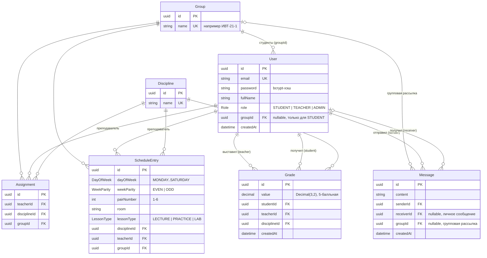

# Диаграмма базы данных

Источник: [`backend/prisma/schema.prisma`](backend/prisma/schema.prisma) (PostgreSQL).
Диаграмма в формате Mermaid — отображается на GitHub/GitLab и в VS Code (расширение Markdown Preview Mermaid).

## Перевод названий таблиц

| Таблица         | Перевод                        | Назначение                                        |
| --------------- | ------------------------------ | ------------------------------------------------- |
| `User`          | Пользователь                   | Студент, преподаватель или администратор          |
| `Group`         | Группа                         | Учебная группа                                    |
| `Discipline`    | Дисциплина                     | Учебный предмет                                   |
| `Assignment`    | Назначение (нагрузка)          | Какой преподаватель ведёт дисциплину у какой группы |
| `ScheduleEntry` | Запись расписания              | Одна пара: день, чётность недели, номер, аудитория |
| `Grade`         | Оценка                         | Оценка студента по дисциплине                     |
| `Message`       | Сообщение                      | Личное сообщение или рассылка группе              |

## Примечания

- `Assignment` — связь «многие-ко-многим» преподаватель ↔ дисциплина ↔ группа; уникальна по тройке `(teacherId, disciplineId, groupId)`. От расписания не зависит.
- `Message`: заполнен либо `receiverId` (личное), либо `groupId` (рассылка группе).
- Все внешние ключи, кроме `User.groupId`, имеют `ON DELETE CASCADE`; `User.groupId` — `ON DELETE SET NULL`.
- Перечисления: `Role`, `LessonType`, `WeekParity`, `DayOfWeek` (хранятся как enum PostgreSQL).
